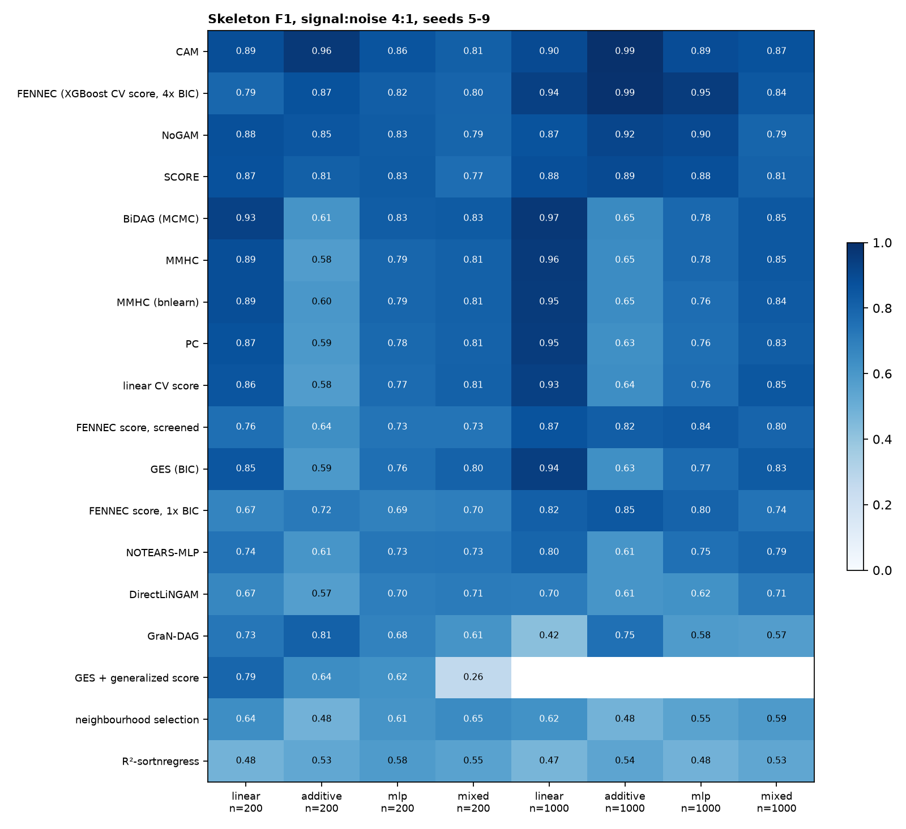
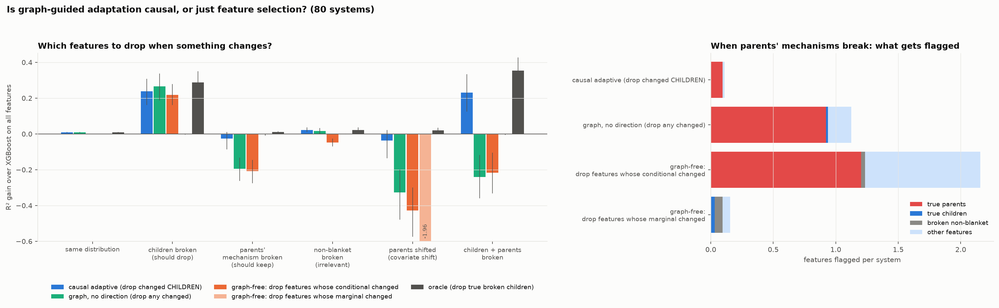
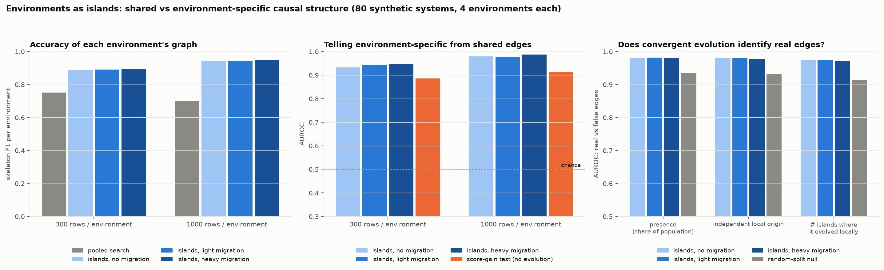

# FENNEC-Search

**F**itness-guided **E**volution of **N**iched **N**etworks for **E**nsemble **C**ausal discovery.

FENNEC-Search scores causal graphs by **how well each variable can be predicted from its parents**,
using cross-validated XGBoost. It then searches graph space with hill climbing and a MAP-Elites
quality-diversity archive. The output is not just one "best" DAG: you also get the **population of
graphs that fit the data about equally well**, plus causal-effect estimates averaged over that
population.

The graphs are treated as *hypotheses that are supported by prediction*, not as recovered truth.
Observational data rarely identify a single DAG, and the question this project cares about is
whether a graph hypothesis makes a downstream predictor more accurate or more robust.

> Status: research code, alpha (v0.1.0). The API may change.

## Install

```bash
git clone <this repo> && cd fennec-search
pip install -e .                       # core package
pip install -e ".[dev]" && pytest      # with tests (8 tests, about 15 seconds)
```

Python ≥ 3.10. Core dependencies are numpy, pandas, scikit-learn, xgboost, networkx, joblib and
dowhy. It was tested with Python 3.11, numpy 2.4, pandas 2.3, scikit-learn 1.8, xgboost 3.2 and
dowhy 0.14. The optional extras are `bench` (the baseline structure learners) and `experiments`
(the figures and tables).

## Quickstart

```python
import pandas as pd
from fennec_search import FennecSearch

df = pd.read_csv("my_data.csv")                 # numeric columns
fs = FennecSearch(n_jobs=4).fit(df)

fs.best_graph_          # (d x d) adjacency matrix, entry [i, j] = 1 means i -> j
fs.population_          # [(adjacency, score), ...]: graphs within the score's noise band of the best
fs.effects(df, [("X3", 1.0, -1.0)])   # E[Y | do(X3=1)] - E[Y | do(X3=-1)] for every Y, with intervals
```

`examples/quickstart.py` runs end to end on a small nonlinear system. The lower-level pieces can
also be used on their own:

```python
from fennec_search import CVScore, hill_climb, MapElites, near_optimal
S = CVScore(X, model="xgb", penalty_mult=4.0)   # X: numpy array (n x d)
g, s = hill_climb(S, mask=None)                 # mask[i, j] = False forbids i -> j (e.g. temporal tiers)
```

## How it works

**Score.** For a graph G, sum over variables j:

$$\text{score}(G) = \sum_j -\tfrac{n}{2}\log \widehat{\mathrm{MSE}}_{\text{CV}}\big(X_j \mid \mathrm{Pa}_G(j)\big) \;-\; \lambda\,|E|, \qquad \lambda = 4 \cdot \tfrac{\log n}{2}$$

(The code divides the whole score by n, which leaves the ranking of graphs unchanged.) This is an
additive-noise likelihood score in the same family as CAM (Bühlmann et al. 2014) and
Huang et al. (2018). The difference is that the regression model is cross-validated gradient
boosting, so it can capture interactions and other non-additive mechanisms. The edge penalty is
4× the BIC penalty (Schwarz 1978). That multiplier was chosen on development seeds and checked on
held-out seeds (see below).

**Search.**
1. Hill climbing (add, delete or reverse an edge) finds a high-scoring DAG.
2. That DAG seeds a MAP-Elites archive, which keeps the best graph in each niche of
   graph-descriptor space (edge density × in-degree).
3. The **near-optimal population** is every evaluated graph whose score lies within the score's
   bootstrap noise band of the best graph.

**Effects.** For each graph in the population, a DoWhy structural causal model is fitted. The
interventional query is answered in each graph and the answers are averaged across graphs. The
spread reflects uncertainty about structure as well as estimation noise.

**Islands (heterogeneous data).** If the data come from several environments (sites, cohorts,
genetic strata), each environment evolves its own population, with optional migration between
them. Comparing the populations shows which edges are shared and which are specific to an
environment, and *which* environment each specific edge belongs to.
This lives in `experiments/exp_islands.py`. It is not yet part of the package API.

## Results

All results below come from synthetic data with a known true graph. Each heatmap cell averages 20
datasets (d = 10 and 20 variables).

### Structure recovery against 14 baselines



Held-out seeds 5–9, skeleton F1:

| | linear | additive | MLP / interaction | mixed |
|---|---|---|---|---|
| **n = 1000**: FENNEC | 0.94 | 0.99 | **0.95** | 0.84 |
| best other method | 0.97 (BiDAG) | 0.99 (CAM) | 0.90 (NoGAM) | 0.87 (CAM) |
| **n = 200**: FENNEC | 0.79 | 0.87 | 0.82 | 0.80 |
| best other method | 0.93 (BiDAG) | 0.96 (CAM) | 0.86 (CAM) | 0.83 (BiDAG) |

How to read this:
- FENNEC is strongest on **interaction (MLP) mechanisms at n = 1000**. Its oriented-edge recall
  there is 0.93, against 0.80 for CAM.
- On additive data it matches CAM.
- At **n = 200 it trails CAM, BiDAG and NoGAM**: cross-validated boosting needs more data.
- When the noise is raised to signal:noise 1:1
  ([figure](results/figures/benchmark_noise1.png)), FENNEC ties CAM at n = 1000 and falls further
  behind at n = 200.
- GraN-DAG was run with default settings and is probably under-tuned.

Regenerate the tables with `python -m benchmarks.summarize [--noise-sd 1]`.

### Prediction under distribution shift: is the graph doing causal work?



Setup: 80 systems. A predictor for an outcome Y is trained, then tested after one part of the
system changes. The policy compared is "drop features that are the outcome's *children* in the
learned graph if they changed". It is tested against XGBoost on all features and against graph-free
rules (drop any feature whose marginal or conditional distribution changed).
Full numbers are in `results/tables/T11a.csv` and `T11b.csv`.

Test R² by what changed in the test data:

| | children broken | parents' mechanism broken | parents shifted | nothing changed |
|---|---|---|---|---|
| XGBoost, all features | 0.40 | 0.84 | **0.68** | 0.83 |
| graph-free, drop features whose conditional changed | 0.62 | 0.63 | 0.25 | 0.83 |
| **causal adaptive (FENNEC graph)** | **0.64** | **0.81** | 0.64 | 0.84 |
| oracle | 0.69 | 0.85 | 0.70 | 0.84 |

How to read this:
- Direction matters. When the outcome's children break, the graph-guided predictor drops them and
  gains about 0.24 R².
- When the parents' own mechanisms break, the graph keeps the parents. A graph-free detector drops
  them and loses about 0.2 R².
- Under a plain covariate shift of the parents, the graph-guided policy is slightly *worse* than
  using all features.
- With no shift, the gain is small (about +0.01).

### Heterogeneity across environments (islands)



Setup: 4 environments in which some edges differ.

- **Per-environment F1.** One population per environment ("islands") reaches skeleton F1 0.95 per
  environment at 1000 rows per environment. A single pooled search reaches 0.70 (`T12a`).
- **Locating changed edges.** Islands find which environment an edge belongs to with AUROC 0.98.
  The pooled population scores 0.54 (`T12c`).
- **Against CD-NOD and JCI** ([figure](results/figures/fig17_hetero_vs_cdnod.png), `T17a`). For
  which *variables* change across environments, islands score AUROC 0.82, CD-NOD (RCIT) 0.78 and a
  JCI-style FENNEC 0.85. CD-NOD and JCI answer at the node level only. Islands also return the
  changed edge and its environment.
- **Genotype-defined strata are a weak point** (`T17b`). Pathway-PGS "clades" reach AUROC 0.75
  with low sensitivity, below CD-NOD (RCIT, 0.91) and JCI (0.89).

### What is and isn't new

| component | novelty | comment |
|---|---|---|
| CV-boosting parent score | low | an additive-noise likelihood score with a flexible regressor; closest prior work is CAM and boosting-based CAM variants |
| MAP-Elites population of near-optimal DAGs | moderate | quality-diversity search for causal structure is uncommon. The population feeds effect estimates that are averaged over structure |
| Islands for environment-specific edges | moderate–high | edge-level and environment-level answers, which CD-NOD and JCI do not give |
| Direction-aware feature dropping under shift | moderate–high | tests whether the graph does causal work beyond feature selection |

## Repository layout

```
src/fennec_search/   the package: score, graph operators, search (hill climb, MAP-Elites), ensemble, effects
tests/               pytest suite
examples/            quickstart
benchmarks/          synthetic generator, 14 baseline methods + ablations, runner, summary (see benchmarks/README.md)
experiments/         exp_*.py run an experiment -> results/raw/*.jsonl; analyze_*.py -> figures + tables
results/figures/     figures used in this README
results/tables/      CSV tables behind them
```

Reproducing an experiment, for example the causal test:

```bash
pip install -e ".[experiments,bench]"
python -m experiments.exp_outcome_causal_test      # writes results/raw/outcome_causal_test.jsonl
python -m experiments.analyze_causal_test          # writes results/figures/fig10_causal_test.png and T11*.csv
```

The experiments are CPU-heavy (hours on a cluster node). Raw outputs are not tracked in git.

## Roadmap

The next step is a **graph → predictor "compiler" interface**: a graph goes in and a fitted
predictor comes out, through several mechanisms (Markov-blanket selection, parent-only models,
graph-informed ensembles, shift-aware feature dropping). It will come with an experiment that
measures prediction gain against graph quality, using oracle, random and learned graphs.

## Citation

A paper is in preparation. Until then, please cite this repository:

```bibtex
@software{fennec_search,
  title   = {FENNEC-Search: Fitness-guided Evolution of Niched Networks for Ensemble Causal discovery},
  version = {0.1.0},
  year    = {2026}
}
```

## References

- Bühlmann, Peters & Ernest (2014). CAM: Causal additive models, high-dimensional order search and penalized regression. *Annals of Statistics*.
- Huang et al. (2018). Generalized score functions for causal discovery. *KDD*.
- Huang et al. (2020). Causal discovery from heterogeneous/nonstationary data (CD-NOD). *JMLR*.
- Mooij, Magliacane & Claassen (2020). Joint causal inference from multiple contexts (JCI). *JMLR*.
- Mouret & Clune (2015). Illuminating search spaces by mapping elites. *arXiv:1504.04909*.
- Reisach, Seiler & Weichwald (2021). Beware of the simulated DAG! *NeurIPS*.
- Reisach et al. (2023). A scale-invariant sorting criterion to find a causal order in additive noise models. *NeurIPS*.
- Rolland et al. (2022). Score matching enables causal discovery of nonlinear additive noise models (SCORE). *ICML*.
- Montagna et al. (2023). Causal discovery with score matching on additive models with arbitrary noise (NoGAM). *CLeaR*.
- Schwarz (1978). Estimating the dimension of a model. *Annals of Statistics*.

## License

To be decided.
