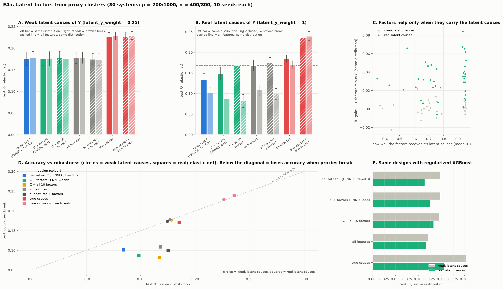
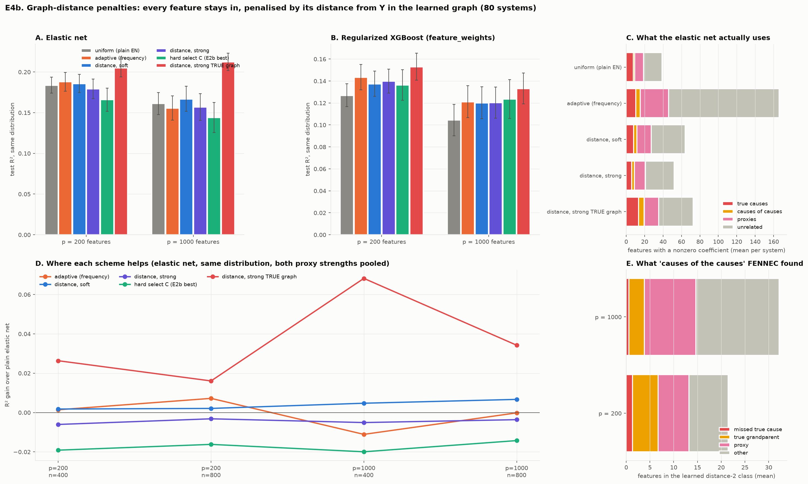
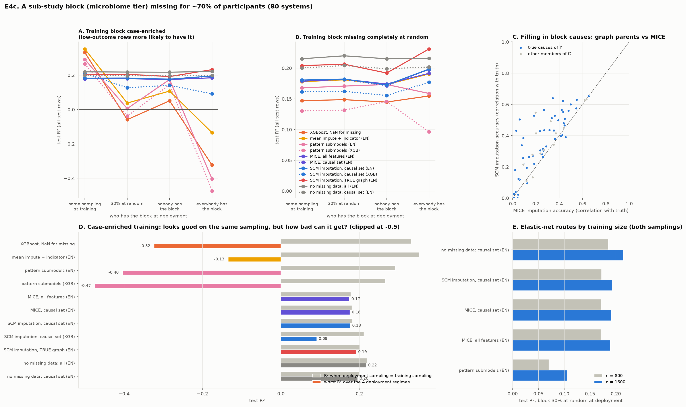

# E4: using the causal graph inside the model

*Run 20 Nov 2026. Code: `experiments/e4ab_inmodel.py`, `experiments/e4c_missing.py`, analysis
`experiments/analyze_e4.py`, configs `experiments/configs/e4ab.json`, `e4c.json`. Tables:
`results/tables/E4a_*.csv`, `E4b_*.csv`, `E4c_*.csv`, `TABLES_e4.md`. All synthetic data; nothing from CHILD.*

## Why these experiments

E1–E2c showed that, when the outcome is measured last, a causal graph mostly acts as a **feature
selector**: its value is knowing *which* variables are the outcome's direct causes. That selection
works (a handful of features matches elastic net on hundreds; it helps regularized XGBoost by about
+0.02 R²), but it hits a ceiling: at n ≤ 800 with many small effects, FENNEC finds only 4–6 of the
15 true causes, and the true-cause oracle sits +0.045 to +0.065 R² higher.

A graph contains more than the outcome's parent set. E4 tests three ways of putting the rest of it
*inside* the predictor:

| | idea | the graph information it uses |
|---|---|---|
| **E4a** | latent factors from proxy clusters | which measured variables share an **unmeasured** cause |
| **E4b** | graph-distance penalties | each feature's **distance from Y** (cause, cause of a cause, unrelated) |
| **E4c** | SCM imputation of a missing block | the **causes of each missing variable** |

### The simulated cohort (same generator for all three)

`benchmarks/generate_cohort.py`, CHILD-like but synthetic:

- **Features.** p features in 4 time-ordered tiers: genetics 15%, prenatal 25%, early life 30%,
  microbiome-like 30%.
- **The outcome Y** is measured after every tier, so it has no measured children.
- **Causes of Y.** It has 15 direct causes with mostly small effects, plus 2 interactions.
- **Unmeasured factors.** Six of them each drive a block of about p/10 correlated features (think
  "shared microbial ecology" or "household environment").
- **Unmeasured causes of Y.** Two of those factors also cause Y, so their measured children are
  **proxies**: correlated with Y, but not its causes.
- `latent_y_weight` sets how strongly Y depends on the two unmeasured causes:
  - **0.25 = weak** (the E2b regime, matching your description of CHILD: extra features are mostly
    noise);
  - **1.0 = real** (proxies carry genuine signal).
- **Noise and types.** The signal explains 30% of Y's variance, and 30% of the features are binary.

**Shift regimes** (test sets only):

| regime | what changes | real-world analogue |
|---|---|---|
| same distribution | nothing | a new sample from the same cohort |
| proxies break | the unmeasured factors feeding the measured features are redrawn independently of the ones feeding Y; proxies keep their spread but lose their link to Y | a marker that means something different at another site |
| causes shift | Y's measured causes move +1 SD; mechanisms are unchanged | a population with higher exposure levels |

### The two predictors used throughout
- **Elastic net (EN):** penalised linear regression; its penalty strength and L1/L2 mix are chosen
  by 5-fold cross-validation on the training rows. This was the best model on CHILD.
- **Regularized XGBoost:**
  - depth-2 trees, learning rate 0.02;
  - at least 20 observations' worth of weight per leaf (min_child_weight 20), L2 penalty 10;
  - 50% of features sampled per split;
  - early stopping on an internal 20% split of the training rows.

  This is the "heavily constrained boosting" you asked about.

### FENNEC's causal set C (used by all three)
- **Population frequency.** On the training rows, run FENNEC's outcome-local search (linear CV
  score, 1× BIC penalty) on 30 half-size subsamples, and record how often each feature is chosen.
- **The set.** C = features chosen in at least 30% of runs.
- **Settings.** Every setting was fixed in the config before running, and no choice looked at
  test data.

---

## E4a: latent factors from proxy clusters

### Background
- **Proxies.** When an unmeasured variable U causes Y, its measured children (proxies) each carry a
  little information about U, mixed with their own noise. One proxy is a poor stand-in for U, but
  the *average* of many proxies is a good one: the noise averages out and U remains.
- **Factor models.** This is the logic of factor models and principal components:
  - "diffusion indexes" in economic forecasting, Stock & Watson 2002 (JASA), forecasting from
    principal components of many predictors;
  - the measurement models of structural equation modelling;
  - the "deconfounder", Wang & Blei 2019 (JASA).
- **Graph view.** A factor model *estimates the latent nodes of the graph*.
- **Why it might help.**
  - Selecting only the causes throws away every proxy, so the part of Y driven by U is lost.
  - Using all features keeps the proxies, but as hundreds of separate tiny coefficients, each
    estimated with noise.
  - Factors compress them into a few denoised features.
- **The risk.** Factors are built from proxies, so if the proxy–Y link changes (proxies break),
  anything resting on factors breaks too.

### Designs compared

| design | features given to the model |
|---|---|
| causal set C | FENNEC's causal set only |
| C + factors FENNEC adds | C, plus whichever of 10 principal components FENNEC's search adds given C |
| C + all 10 factors | C plus all 10 principal components of the training features |
| all features (± factors) | the usual baseline |
| true causes | the 15 real causes (oracle) |
| true causes + true latents | oracle plus the *actual* values of Y's two unmeasured causes (unobservable ceiling) |

### How to read the figure
- **A and B: R² for elastic net.** Left bar of each pair = same distribution; right, faded bar =
  proxies break. Dashed line = all features. Hatched bars contain factors.
- **C: does a factor gain depend on recovering the latent?** One dot per system. x = how well the 10
  factors recover Y's unmeasured causes; y = the R² gain from adding them to C.
- **D: accuracy against robustness.** x = R² with no shift; y = R² when proxies break. Points below
  the diagonal lose accuracy under shift.
- **E: the same designs with regularized XGBoost.**

### Results (80 systems; p = 200/1000, n = 400/800, both latent strengths)

**Weak latent causes (your CHILD-like setting):**

| design (elastic net) | R² same | R² proxies break |
|---|---|---|
| causal set C | 0.176 | 0.177 |
| C + all 10 factors | 0.178 (+0.002, n.s.) | 0.176 |
| all features | 0.177 | 0.178 |
| true causes | 0.226 | 0.228 |

- **Factors add nothing.** FENNEC agrees: it adds a factor in only 0.1–0.3 of systems. That's the
  right call, since there's no latent signal to recover.
- **Trees benefit from selection.** For regularized XGBoost, C beats all features by **+0.026**
  [+0.014, +0.038], and factors don't change that.

**Real latent causes:**

| design (elastic net) | R² same | vs C | R² proxies break | drop under shift |
|---|---|---|---|---|
| causal set C | 0.134 | n/a | 0.101 | −0.033 |
| C + factors FENNEC adds | 0.148 | +0.014 | 0.087 | −0.061 |
| C + all 10 factors | 0.167 | **+0.033** | 0.082 | **−0.085** |
| all features | 0.168 | +0.034 | 0.109 | −0.059 |
| all features + factors | 0.175 | +0.041 | 0.099 | −0.076 |
| true causes | 0.185 | +0.051 | 0.170 | −0.015 |
| true causes + true latents | 0.236 | +0.102 | 0.239 | +0.003 |

**Factor recovery** (R² of each true latent on the 10 factors):
- **0.63–0.69 at p = 200, 0.94–0.95 at p = 1000.** More features means more proxies of each latent,
  so the factor estimate improves: the "blessing of dimensionality" of factor models.

### Interpretation
1. **Factors recover what causal selection throws away, but only when it exists.** With real latent
   causes, C + factors closes the whole gap to all features (+0.033). Panel C shows the gain appears
   only when latents matter (green dots above 0, grey dots on 0).
2. **They inherit the fragility of proxies.** Under proxy break, the factor designs lose the most
   (−0.061 to −0.085), more than all features (−0.059). Panel D shows it: the factor designs sit
   furthest below the diagonal. This is the same accuracy-against-robustness trade-off as before,
   made explicit.
3. **Why the true causes also drop a little (−0.015).** Several of Y's causes belong to the same
   latent blocks, so in training their coefficients partly encode Y's unmeasured causes (omitted-
   variable bias). Proxy break removes that shared part. Only true causes plus true latents is
   fully stable, which is the textbook "model the whole causal mechanism" result.
4. **FENNEC's selective factor addition sits in between** (+0.014 gain, −0.061 drop).
5. **The big remaining gap is to "true causes + true latents" (0.236).** The factors do recover the
   latents at p = 1000 (R² 0.95), but they arrive rotated and mixed with the other four unmeasured
   factors, and the model still lacks most of the measured causes.

**Verdict:** worth doing when unmeasured causes really drive the outcome; harmless when they don't.
It is **not** a robustness method.

---

## E4b: graph-distance penalties

### Background
- **One penalty for everyone.** An elastic net penalises every coefficient equally. Differential
  shrinkage gives each feature its own penalty factor:
  - the **adaptive lasso** (Zou 2006, JASA) weights penalties by an initial estimate;
  - **glmnet's `penalty.factor`** implements per-feature penalties directly;
  - in Bayesian terms, it is a prior with a different inclusion probability for each feature.
- **Why soften instead of select.** Hard selection (E2b) is all or nothing: a true cause FENNEC
  missed is gone for good. A graph-informed penalty keeps every feature available but makes
  graph-distant ones expensive.
- **Two hoped-for benefits:**
  - **recall:** missed causes can still enter if the data insist;
  - **"causes of causes" as backup:** if a parent is missed or measured with noise, its own parents
    carry part of its signal.

### Schemes
- **Implementation.** Each feature enters the elastic net scaled by s, so its L1 penalty factor is
  1/s (L2: 1/s²).
- **Distance classes from the learned graph:**
  - distance 1 = C;
  - distance 2 = the parents of members of C, from a FENNEC local search per member;
  - distance 3 = everything else.

| scheme | s for distance 1 / 2 / 3 |
|---|---|
| uniform | 1 / 1 / 1 (plain elastic net) |
| adaptive | population frequency + 0.05 |
| distance, soft | 1 / 0.5 / 0.2 (penalty factors 1, 2, 5) |
| distance, strong | 1 / 0.3 / 0.05 (penalty factors 1, 3.3, 20) |
| hard select C | C only (the E2b best) |
| distance, strong, TRUE graph | distance classes from the real graph (oracle) |

- **For XGBoost:** the same s values go in as `feature_weights`, with 30% of features sampled per
  split, so splits are drawn mostly from graph-near features.

### How to read the figure
- **A and B:** R² by scheme and number of features.
- **C:** which features end up with a nonzero elastic-net coefficient, coloured by their *true*
  role.
- **D:** where each scheme gains over plain elastic net, by setting.
- **E:** what FENNEC's learned "causes of the causes" class actually contains.

### Results

| scheme | EN: gain vs plain EN (same) | EN: gain (proxies break) | XGB: gain vs plain reg. XGBoost (same) | XGB: share of systems better |
|---|---|---|---|---|
| adaptive (frequency) | −0.001 | −0.015 | **+0.017** [+0.013, +0.020] | 95% |
| distance, soft | **+0.004** [+0.000, +0.007] | +0.001 | +0.013 | 88% |
| distance, strong | −0.004 | −0.004 | +0.014 | 88% |
| hard select C | −0.017 | −0.004 | +0.014 (proxies break: **+0.028**) | 73% |
| distance, strong, TRUE graph | **+0.036** | **+0.046** | +0.027 | 99% |

**Where the elastic-net gains are** (panel D):
- **Soft distance penalties** do best at p = 1000 with weak latents (+0.009 to +0.011).
- **Hard selection** helps regularized XGBoost most at p = 1000 with weak latents (+0.035 to
  +0.046), which is your "noisy features hurt trees" situation.

**What the learned distance classes contain** (panel E, p = 1000, n = 800):
- **The distance-2 class** has 40 features. Only 4.5 are true grandparents, 0.6 are causes C
  missed, 13.7 are proxies, and the rest unrelated.

### Interpretation
1. **The idea works with the right graph.** With the true graph, distance penalties gain +0.036
   (+0.046 under proxy break) for elastic net, in 94% of systems. Panel C shows why: the true-graph
   version uses 13.5 of the 15 causes, against 7.8 for plain elastic net, while keeping proxies and
   noise at the same level.
2. **With the learned graph, elastic-net gains are small** (soft: +0.004). FENNEC's "causes of the
   causes" are mostly proxies and noise. A weak feature's own parents are even harder to find than
   Y's, and proxies look like parents because they share an unmeasured driver with them. Softening
   the penalty on the wrong features doesn't help.
3. **The adaptive scheme backfires for elastic net.** Cross-validation responds to the unequal
   weights by lowering the overall penalty, and 120 unrelated features enter (panel C).
4. **For regularized XGBoost, graph weighting is a reliable small win:** +0.013 to +0.017 in
   88–95% of systems. Steering splits toward FENNEC's features is the most consistently positive
   tree result so far. Hard selection is best when proxies break (+0.028) and at p = 1000 with
   weak latents.

**Verdict:** the mechanism is sound, but the learned graph two steps out from Y is not good enough
to exploit it. For trees, frequency or distance feature weights are a cheap, nearly always positive
add-on.

---

## E4c: a sub-study block missing for most participants

### Background

**Types of missingness** (Rubin 1976, Biometrika):
- **MCAR:** missing completely at random.
- **MAR:** missing depends only on observed variables.
- **MNAR:** missing depends on the unobserved values themselves, or on the outcome.

**CHILD's situation.** Microbiome, HMO and methylation sub-studies were run on case-enriched
sub-samples. Whether a child *has* the block depends on their outcome, which is a form of selection
on the outcome.

**The graph view (m-graphs; Mohan, Pearl & Tian 2013, NeurIPS):**
- Add a node R, "block observed", to the causal graph. With case-enriched sampling, **R is a child
  of Y**.
- Any model that can read R uses an effect of the outcome to predict the outcome. That is leakage,
  and it lasts only as long as the sampling stays the same.
- Ways a model can read R:
  - a missing indicator;
  - XGBoost's learned default direction for NaN;
  - pattern submodels.
- **This is a causal-graph argument for how to handle missing data**, quite apart from learning
  any graph.

**Standard approaches:**
- **Missing indicator:** flag the missing rows and let the model use the flag.
- **XGBoost native NaN handling:** the trees learn which way to send missing values.
- **Pattern submodels** (Fletcher Mercaldo & Blume 2020, Biostatistics): one model per missingness
  pattern.
- **MICE** (multiple imputation by chained equations; van Buuren & Groothuis-Oudshoorn 2011, JSS):
  fill each variable from the others in turn.
- **Prediction-specific guidance:** Sperrin et al. 2020 (J Clin Epidemiol) argue missing data should
  be handled differently for prediction than for explanation.

**SCM imputation (the graph-based option):** fill a missing variable from **its causes** in the
graph, i.e. the earlier-tier variables that are always observed. That uses only information that
legitimately precedes it, and gives a fitted model of how the block is generated.

### Design
- **The block:** the microbiome tier (30% of features, containing 4–5 of Y's 15 causes).
- **Training sampling:** observed for 30% of training rows, either completely at random or
  **case-enriched** (P(observed) rises steeply as Y falls). The sampled rows then have mean Y of
  −0.82 SD.
- **Deployment scenarios (who has the block in the test set):** same sampling as training; 30% at
  random; nobody; everybody.

### How to read the figure
- **A and B:** R² across the four deployment scenarios, for case-enriched (A) and random (B)
  training sampling. Flat lines are robust; steep lines depend on who is missing.
- **C:** per-variable imputation accuracy for block members of C. Above the diagonal, graph parents
  beat MICE.
- **D:** case-enriched training, comparing the R² that looks good on matching data (grey) with the
  worst deployment scenario (coloured).
- **E:** routes by training size.

### Results

**Case-enriched training:**

| method | same sampling | 30% at random | nobody has block | everybody has block | worst case |
|---|---|---|---|---|---|
| XGBoost, NaN for missing | **0.332** | −0.059 | 0.051 | −0.323 | **−0.32** |
| mean impute + indicator (EN) | **0.352** | 0.037 | 0.107 | −0.134 | −0.13 |
| pattern submodels (EN) | 0.292 | 0.005 | 0.175 | −0.404 | −0.40 |
| MICE, all features (EN) | 0.178 | 0.179 | 0.175 | 0.185 | 0.17 |
| SCM imputation, causal set (EN) | 0.183 | 0.183 | 0.177 | 0.195 | 0.17 |
| SCM imputation, causal set (XGB) | 0.211 | 0.127 | 0.141 | 0.091 | 0.08 |
| SCM imputation, TRUE graph (EN) | 0.202 | 0.205 | 0.192 | 0.232 | 0.19 |
| no missing data, all features (EN) | 0.219 | 0.218 | 0.217 | 0.221 | 0.21 |

**Training sampled at random:** every method is stable across scenarios (ranges 0.02–0.06).
Native-NaN XGBoost and the pattern models are 0.01–0.05 below MICE and SCM.

**Imputation accuracy** (correlation of the filled-in value with the truth):
- **SCM 0.30–0.37, MICE 0.21–0.28.** Graph parents beat MICE for almost every block cause
  (panel C).

### Interpretation
1. **The headline is the leak, not the imputer.**
   - Under case-enriched sampling, every method that can see *who* has the block scores 0.29–0.35 on
     matching test data. That's **better than having no missing data at all (0.22)**, which can only
     be leakage.
   - When deployment sampling differs, they collapse to **−0.13 to −0.47**, worse than predicting
     the mean.
   - In the graph picture, they condition on R, a child of Y.
   - This reproduces, in controlled form, the sub-study missingness problem you flagged in CHILD.
2. **Imputing without the outcome fixes it.** MICE and SCM imputation with elastic net stay within
   0.03 R² across all four scenarios.
3. **SCM imputation fills in each variable better than MICE** (correlation about +0.1). Final
   prediction is about the same (+0.004 vs MICE, n.s.), for two reasons:
   - only about 1 of C's 4–7 features is in the block, since FENNEC found few block causes with
     240–480 complete rows;
   - an imputed value correlated about 0.35 with the truth carries little signal anyway.

   With the **true graph**, SCM imputation gains +0.026 over MICE, about two-thirds of the
   information lost to missingness (no missing data: +0.04).
4. **Trees leak even through imputed values.** SCM imputation + XGBoost scores 0.211 on matching
   data and 0.08 in the worst case. Imputed values are a smooth function of a few parents, so a tree
   can recognise which rows were imputed and recover the missing indicator. **For tree models, use
   stochastic imputation (add residual noise) or multiple imputation, not single deterministic
   imputation.** This qualifies the "impute for XGBoost" fix noted for CHILD.

**Verdict:** the most practically important finding in E4.
- **Never let the model see the missingness pattern when sub-study sampling is case-enriched.** Use
  outcome-free imputation with a linear model, or stochastic imputation for trees.
- **Graph-based imputation is principled and imputes each variable better.** Its prediction gain
  over MICE depends on finding the block's causes, which is again the graph-quality bottleneck.

---

## Across E4: what it adds up to

1. **Every mechanism works with the true graph.** Oracle versions gain:
   - +0.036 for distance penalties;
   - +0.026 over MICE for SCM imputation;
   - +0.10 for true causes plus true latents.

   The ideas are right.
2. **With FENNEC's learned graph the gains shrink to about 0–0.02,** because, at n ≤ 800 with small
   effects, the learned graph is only reliable at distance 1 from Y, and even there only for the
   stronger causes. Everything that needs the graph further out (grandparents, the causes of block
   variables) inherits that weakness.
3. **Regularized XGBoost benefits most and most consistently:**
   - +0.013 to +0.017 from graph feature weights (88–95% of systems);
   - +0.026 to +0.046 from hard selection in the noisy, many-feature regime.

   It still trails elastic net, because the simulated mechanisms are mostly linear.
4. **The strongest, most defensible result is causal reasoning about the data-collection
   process (E4c).** Treating sub-study inclusion as a child of the outcome tells you not to use
   missingness at all. That turns a leaking model (worst case R² −0.32) into a stable one (worst
   case 0.17). It needs no structure learning, only the right graph for how the data were
   collected.

### Suggested next steps
- **E4c with stochastic or multiple imputation** for trees, and a CHILD-design version with real
  sub-study fractions. This is directly publishable as a methods point for cohort prediction.
- **More power for finding block causes:** run FENNEC on all rows using an EM-style loop (impute,
  select, re-impute) instead of complete rows only.
- **Factor features (E4a) on CHILD itself:** check whether microbiome or exposure clusters carry
  outcome signal from unmeasured causes, which is the only case where they help.
- **Report graph weights in XGBoost as a default add-on** in the FENNEC pipeline.
